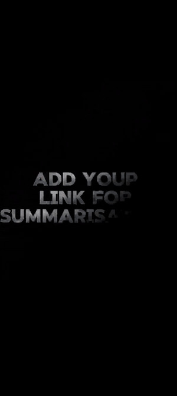
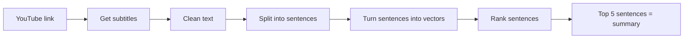

<p align="center">
  
</p>

<p align="center">
  
</p>

<p align="center">
  
  
  
  
</p>

## What is this?

Long videos take a lot of time to watch. This project reads the **subtitles** of a video and makes a **short summary** with the most important sentences.

I tested **5 different methods** on **523 YouTube videos** and compared them with ROUGE scores.

## Demo

<p align="center">
  
</p>

You paste a video link, press **Get Summary**, and the app shows the summary.

## How it works



## The 5 methods

| # | Method | How it picks sentences |
|---|--------|------------------------|
| 1 | TF-IDF + PageRank | Word counts, then a graph ranks the sentences |
| 2 | Doc2Vec + HITS | Learns a vector for each sentence, then HITS ranks them |
| 3 | T5 | A transformer **writes** a new short summary |
| 4 | SentenceTransformer + HITS | Pre-trained `all-MiniLM-L6-v2` vectors, then HITS |
| 5 | FastText + HITS | Trains its own word vectors, then HITS |

## Results

Average scores on 517 videos (higher is better):

| Method | ROUGE-1 F1 | ROUGE-2 F1 |
|--------|:---------:|:---------:|
| TF-IDF | 0.278 | 0.138 |
| Doc2Vec | 0.325 | 0.142 |
| T5 | 0.371 | 0.197 |
| **SentenceTransformer** 🏆 | **0.391** | **0.207** |
| FastText | 0.388 | 0.194 |

**What I learned:**
- **SentenceTransformer** gave the best results overall.
- **T5** had the best recall. It catches more of the main ideas because it writes new sentences.
- Simple methods like TF-IDF are faster, but their scores are lower.

## Data

`mr_beast.csv`: 523 MrBeast videos. Each row has the full subtitles (`text`) and a reference summary (`summary`).

## How to run

```bash
pip install pandas numpy nltk gensim scikit-learn networkx transformers sentence-transformers rouge
```

```python
import nltk
nltk.download("punkt")
```

Then open `TFIDF_vs_Doc2Vec__vs_T5_vs_Transformer_vs_FastText.ipynb` and run all cells.

## Files

```
├── TFIDF_vs_Doc2Vec__vs_T5_vs_Transformer_vs_FastText.ipynb   # all the code
├── demo.mp4                                                    # full app demo
├── assets/demo.gif                                             # short demo
└── README.md
```

## Next steps

- [ ] Try more metrics like BERTScore
- [ ] Support Arabic videos
- [ ] Mix extractive and abstractive summaries

<p align="center">
  
</p>
